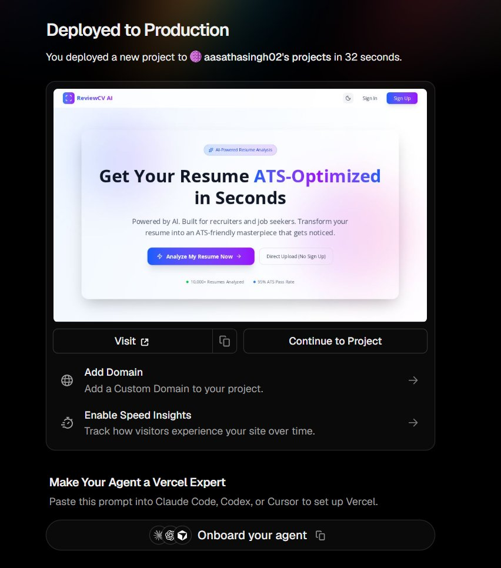
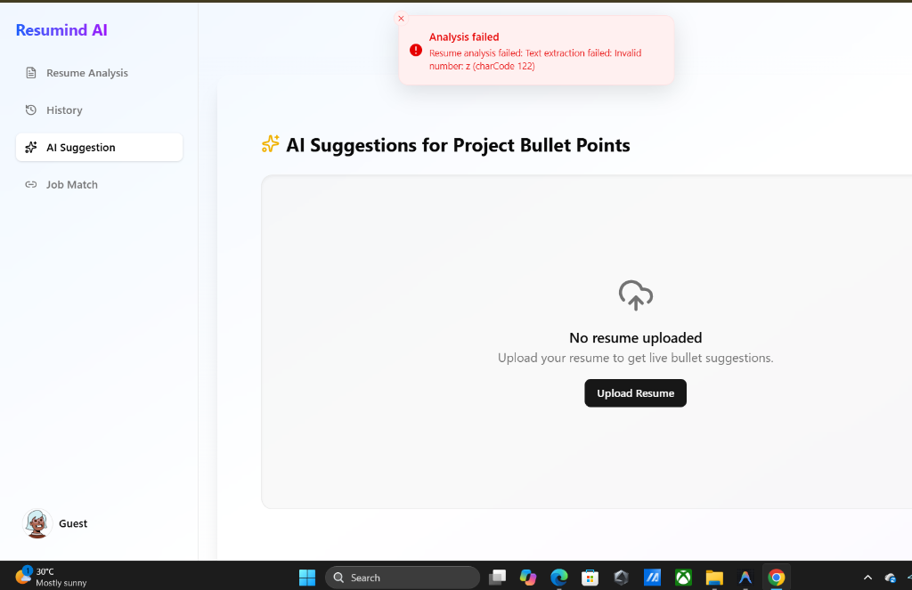
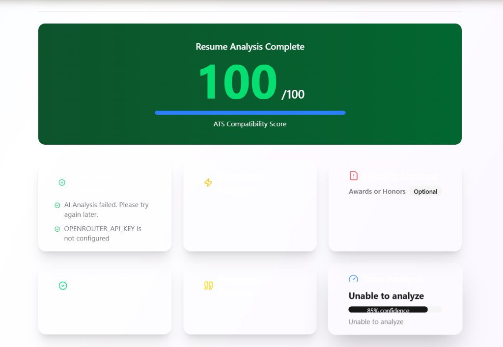
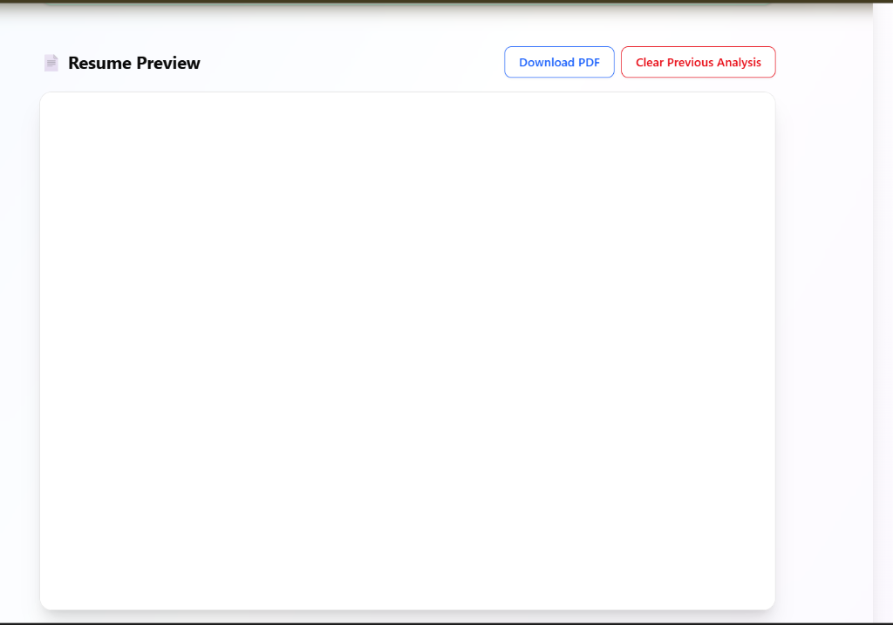
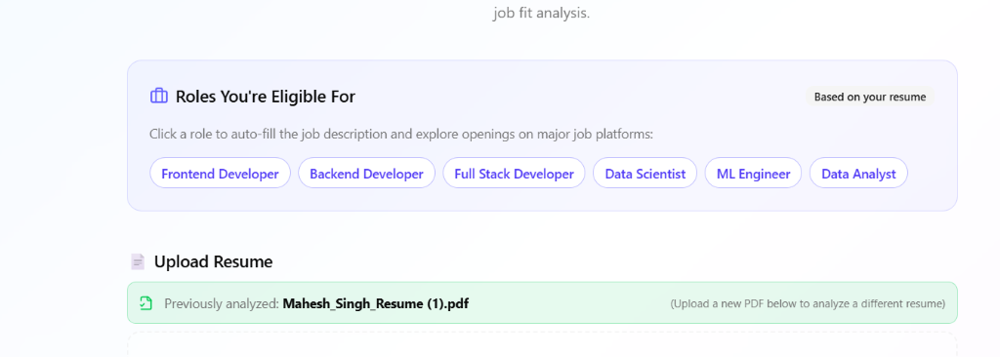
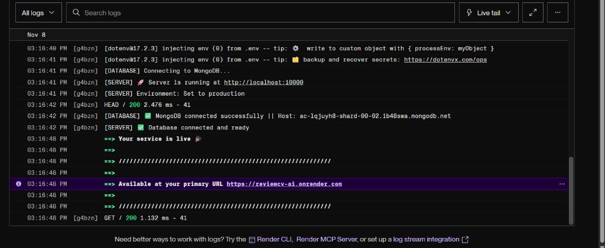

# 📄 ReviewCV AI - AI Resume Analyzer, ATS Optimizer & Job Discovery

[](https://review-cv-ai.vercel.app)
[](https://reviewcv-ai.onrender.com/api/health)
[](https://www.mongodb.com/)
[](#-tech-stack)
[](https://github.com/AasathaSingh02)

**ReviewCV AI** is a modern, production-ready AI-powered career platform. It calculates comprehensive ATS scores, audits resume sections, identifies overused buzzwords, extracts high-impact action verbs, rewrites weak bullet points using AI, automatically identifies eligible job roles, and discovers live job openings across top recruitment platforms.

---

## 🌐 Live Production URLs

| Component | Platform | Status | Live URL |
|---|---|---|---|
| **Frontend Web App** | Vercel | 🟢 Online | [https://review-cv-ai.vercel.app](https://review-cv-ai.vercel.app) |
| **Backend REST API** | Render | 🟢 24/7 Awake | [https://reviewcv-ai.onrender.com](https://reviewcv-ai.onrender.com) |
| **Uptime Health Check** | Render / UptimeRobot | 🟢 200 OK | [https://reviewcv-ai.onrender.com/api/health](https://reviewcv-ai.onrender.com/api/health) |

---

## 📸 Application Preview & How It Works

### 1. Modern Glassmorphism Landing Page & Live Scanner Demo
Fast, responsive interface built with React, Vite, Tailwind CSS, and Framer Motion. Features a live real-time ATS scanner mockup right in the hero section.


---

### 2. Direct Resume Upload (Guest & Authenticated Mode)
Users can drag & drop any PDF resume directly without mandatory login friction, or create an account with OTP email verification.


---

### 3. Instant ATS Compatibility Score & In-Depth Diagnostic Cards
Evaluates resumes on structure, keyword density, section completeness (Summary, Experience, Projects, Skills, Education, Certifications, Awards), tone confidence, and generates actionable improvements.


---

### 4. In-App Resume Preview & Instant PDF Download
Seamless PDF preview embedded in the browser with one-click direct PDF download and "Open in New Tab" capabilities. Built with persistent MongoDB base64 storage to survive cloud restarts.


---

### 5. AI Job Match & Eligible Roles Discovery
Analyzes resume skills to automatically recommend eligible job roles (e.g. Frontend Developer, Backend Developer, Data Scientist) and enables 1-click live job searches across LinkedIn, Naukri, Indeed, Internshala, and Glassdoor.


---

### 6. Cloud-Connected Backend & Live MongoDB Atlas
Node.js + Express backend running live on Render, connected to MongoDB Atlas with graceful failover, automated multi-tier PDF parsing, and UptimeRobot continuous monitoring.


---

## 🌟 Key Features

* **🎯 Instant ATS Compatibility Scoring (1–100 scale):** Deeply evaluates formatting, section balance, metrics, keywords, and density.
* **💼 Eligible Job Roles & 1-Click Multi-Platform Search:** Automatically analyzes candidate skills and detects eligible job titles (e.g. Frontend Developer, Data Scientist, DevOps Engineer) with 1-click live search on:
  * **LinkedIn Jobs**
  * **Naukri.com**
  * **Indeed**
  * **Internshala**
  * **Glassdoor**
* **✍️ AI Bullet-Point Rewriter:** Extracts project bullet points and suggests quantified, high-impact rewrites with auto-loading from your previous resume analysis.
* **📂 Resume Scan History & Re-scoring:** Automatically stores historical resume evaluations with the ability to view, re-score, or download past reports.
* **⚡ 24/7 Zero-Cold-Start Architecture:** Dedicated `/api/health` route pinged every 5 minutes by UptimeRobot to ensure instantaneous response times without Render free-tier sleep.
* **🛡️ Persistent PDF Storage:** Stores PDFs as base64 in MongoDB when cloud storage is unconfigured, preventing file loss on ephemeral hosting.
* **🤝 Built-in Privacy & Terms Modals:** Interactive, transparent privacy policy and terms of service directly accessible from the footer.
* **🚀 Dual-Engine AI Pipeline:** Cloud LLM via OpenRouter + smart local heuristic analyzer fallback ensures the service never crashes even during API rate limits.

---

## 🛠️ Tech Stack

### Frontend:
* **React 18** with **TypeScript** & **Vite**
* **Tailwind CSS** + **shadcn/ui** (Radix UI primitives)
* **Redux Toolkit** for centralized state management
* **Framer Motion** for smooth hardware-accelerated animations
* **Lucide Icons** & **Sonner** toast notifications

### Backend:
* **Node.js** & **Express 5**
* **MongoDB Atlas** with **Mongoose** ORM
* **PDF-Parse & PDF2JSON** multi-tier text extraction
* **OpenRouter AI API** (Gemini 2.0 Flash / DeepSeek)
* **Resend API** with resilient dev-mode fallback for email OTPs
* **JWT & Cookie-Parser** for secure authentication

---

## 📡 API Endpoints

| Method | Endpoint | Description |
|---|---|---|
| `GET` | `/api/health` | Lightweight uptime ping route for UptimeRobot |
| `POST` | `/api/resume/analyze` | Upload resume PDF, extract text, and run AI ATS analysis |
| `POST` | `/api/resume/ai-suggestion` | Extract project bullet points and generate AI rewrites |
| `GET` | `/api/resume/history` | Retrieve user's historical resume reports |
| `GET` | `/api/resume/file/:reportId` | Stream stored PDF document for in-app preview |
| `POST` | `/api/job/match` | Evaluate candidate resume against a target job description |
| `POST` | `/api/auth/signup` | Register new user account with OTP |
| `POST` | `/api/auth/login` | Authenticate user and issue JWT |

---

## 📁 Project Structure

```text
ReviewCV-AI/
├── client/                     # React + Vite + TypeScript Frontend
│   ├── src/
│   │   ├── app/                # Redux store, feature slices, and API services
│   │   ├── components/         # UI components & landing page sections
│   │   │   ├── landing/        # Hero, Features (6 cards), HowItWorks, Footer
│   │   │   └── ui/             # Radix UI / shadcn components (Dialog, Button, etc.)
│   │   ├── pages/              # ResumeAnalysis, JobMatch, Rewrite, History, Auth
│   │   └── types/              # TypeScript interfaces (AnalysisDetails, User, etc.)
│   ├── vercel.json             # Vercel client-side routing rewrites
│   └── package.json
│
├── server/                     # Node.js + Express Backend
│   ├── src/
│   │   ├── config/             # MongoDB Atlas connection
│   │   ├── controllers/        # Resume, Job Match, and Auth controllers
│   │   ├── middlewares/        # JWT auth, Multer PDF upload, error handler
│   │   ├── models/             # Mongoose schemas (ResumeReport, User, OTP)
│   │   ├── routes/             # Express API routers (resume, jobMatch, auth)
│   │   ├── utils/              # Heuristic analyzer, OpenRouter client, PDF parser
│   │   └── server.js           # Server entry point & /api/health route
│   └── package.json
│
├── docs/screenshots/           # Readme application visual walkthrough assets
├── vercel.json                 # Root Vercel build configuration
└── README.md                   # Project documentation
```

---

## ⚙️ Running Locally

### 1. Clone the Repository
```bash
git clone https://github.com/AasathaSingh02/ReviewCV-AI.git
cd ReviewCV-AI
```

### 2. Install Dependencies
```bash
npm run install:all
```

### 3. Configure Environment Variables

Create `server/.env`:
```env
PORT=5000
NODE_ENV=development
MONGO_URI=your-mongodb-atlas-uri
JWT_SECRET=your-secret-jwt-key
SESSION_SECRET=your-secret-session-key
CLIENT_URL=http://localhost:5173
OPENROUTER_API_KEY=your-openrouter-key (optional: falls back to smart local analyzer)
RESEND_API_KEY=your-resend-key (optional: falls back to dev OTP mode)
```

Create `client/.env`:
```env
VITE_API_BASE_URL=http://localhost:5000/api
```

### 4. Start Development Servers

In two separate terminals:

```bash
# Terminal 1 — Backend:
npm run server

# Terminal 2 — Frontend:
npm run client
```

* Frontend: `http://localhost:5173`
* Backend: `http://localhost:5000`

---

## 👤 Author & Connect

* **Aastha Singh**
* **LinkedIn:** [linkedin.com/in/aasatha-singh](https://www.linkedin.com/in/aasatha-singh)
* **GitHub:** [@AasathaSingh02](https://github.com/AasathaSingh02)
* **Email:** [aasathasingh02@gmail.com](mailto:aasathasingh02@gmail.com)

---

## 📜 License

MIT License © 2026 ReviewCV AI - Developed by Aastha Singh
